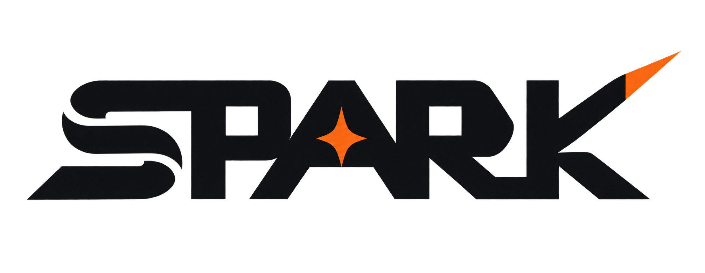

<div align="center">

<h1></h1>
<h3>Adaptive Block Sparse Attention for MiniMax-H3</h3>

<p><strong>Reblock similar tokens · Reweight tail tokens</strong></p>

<p>
  <a href="https://zechengtang.github.io/Spark-H3/"></a>
  
  <a href="https://huggingface.co/Aazeus/Spark-H3"></a>
  <a href="comfyui/README.md"></a>
  <a href="#special-thanks"></a>
  <a href="h3_sparse_attention/README.md"></a>
  <a href="LICENSE"></a>
  <a href="https://github.com/zechengtang/Spark-H3/releases"></a>
</p>

<p>
  <strong>English</strong> · <a href="README.zh-CN.md">简体中文</a>
</p>

<p>
  <a href="#demo">🎬 Demo</a> &nbsp;·&nbsp;
  <a href="#quick-start">🚀 Quick Start</a> &nbsp;·&nbsp;
  <a href="#comfyui-installation">🧩 ComfyUI</a> &nbsp;·&nbsp;
  <a href="https://zechengtang.github.io/Spark-H3/">📖 Technical Blog</a> &nbsp;·&nbsp;
  <a href="#project-status">🧭 Project Status</a>
</p>

</div>

> [!WARNING]
> **Compatibility and release schedule notice (October 25, 2026)**
>
> We have recently received community reports indicating that newer
> `comfy-kitchen` implementations may cause performance regressions with
> certain hardware configurations or workflows. The issue is still under
> investigation, and its impact may vary by environment.
>
> Until the cause is confirmed and resolved, we recommend installing or
> continuing to use the validated and currently more stable **ComfyUI 0.38.x**
> release, and exercising caution when upgrading. See this
> **[community report and comparison video](https://www.bilibili.com/video/BV1RaHK6cEHt/)**
> for additional context.
>
> Consequently, the new release originally planned for **October 27, 2026**
> has been postponed. We will prioritize investigating the `comfy-kitchen`
> issue and resume the release after compatibility and performance have been
> verified. Further updates will be posted in this repository. Thank you for
> your understanding and feedback.

> **ComfyUI v0.1.5:** Adds support for ComfyUI 0.42.x (comfy-kitchen 0.2.39),
> with Linux and Windows packages for SM86, SM89, and SM120. Each package
> also includes wheels for ComfyUI 0.38.x–0.40.x.
> **[Release notes and downloads](https://github.com/zechengtang/Spark-H3/releases/tag/comfyui-v0.1.5)**

> **VPack v0.1.0:** A separate ComfyUI plugin that compresses reference
> videos in Ref2VA workflows.
> **[VPack GitHub repository](https://github.com/zechengtang/VPack)**

> 👉 [Ref2VA 任务加速解决方案](docs/sparse_scope.md#ref2va-任务加速解决方案)

---

<a id="demo"></a>

## 🎬 Demo

Native MiniMax-H3 · VDN Selected Prompt 06 · 1344×768 · 14.4 seconds.
The three panels compare Dense, Spark-H3 Fidelity (2.19×), and Spark-H3 Speed (3.12×).
The animated preview and linked clip cover the final 5.4 seconds, starting at 9 seconds.

[](assets/h3-native-attic-comparison-9s-to-end.mp4)

<p align="center"><a href="https://huggingface.co/Aazeus/Spark-H3/resolve/main/comfyui/demos/H3_native_vdn_selected_0006_dense_fidelity_speed_native_resolution.mp4">Watch the full 14.4-second comparison</a></p>

- [Veda / Sol / Spark: subjective visual quality and speed comparison (Bilibili)](https://www.bilibili.com/video/BV1zynA6aEZG/)
- [Spark-H3 + VPack on Ref2VA (Bilibili)](https://www.bilibili.com/video/BV1i6J163EGG/)

## ✨ Spark-Attn

Spark-Attn is a block sparse attention method for MiniMax-H3 video generation.
It combines two operations:

- **🧩 Reblocking** groups similar tokens into blocks so sparse attention can
  select more relevant interactions.
- **⚖️ Reweighting** assigns different weights to tokens within each tail block
  when building key/value summaries, with a correction for attention mass.

Spark-H3 provides the Spark attention kernels and MiniMax-H3 inference integration.

<a id="quick-start"></a>

## 🚀 Quick Start

Set up your H3 pipeline using the [upstream MiniMax-H3 instructions](https://github.com/MiniMax-AI/MiniMax-H3),
then install Spark in the same environment with a compatible PyTorch/CUDA stack:

```bash
python -m pip install -e '.[cuda]'
```

Wrap an already loaded pipeline with the Spark installer:

```python
from h3_sparse_attention import install_h3_spark_attn

# MiniMaxH3Scheduler includes the terminal sigma=0 in num_inference_steps,
# but that terminal point does not run the transformer.
num_denoise_steps = 19
num_inference_steps = num_denoise_steps + 1

with install_h3_spark_attn(
    pipe.transformer,
    num_denoise_steps=num_denoise_steps,
    warmup_mode="warmup_steps",
    warmup_steps=4,
    dense_layers=0,
    topk_ratio=0.1,
):
    result = pipe(**inputs, num_inference_steps=num_inference_steps)
```

<a id="comfyui-installation"></a>

## 🧩 ComfyUI Installation

Spark-H3 provides standalone nodes for ComfyUI 0.38.x–0.40.x and 0.42.x.
**[v0.1.5](https://github.com/zechengtang/Spark-H3/releases/tag/comfyui-v0.1.5)**
adds ComfyUI 0.42.x support with Linux and Windows x86_64 packages for
SM86, SM89, and SM120. Each package also supports ComfyUI 0.38.x–0.40.x.
Choose the CUDA 13.0 package matching your operating system and GPU
architecture. ComfyUI and model weights are not included.

For installation and example workflows, see the **[ComfyUI guide](comfyui/README.md)**
or **[中文安装指南](comfyui/INSTALL.zh-CN.md)**.

For reference-video compression in Ref2VA workflows, install the separate
**[VPack v0.1.0](https://github.com/zechengtang/VPack)** plugin.

## Step-count convention

`MiniMaxH3Scheduler` includes the final `σ=0` endpoint in
`num_inference_steps`, so the default `num_inference_steps=50` runs 49 denoising steps. See the
[Hugging Face scheduler documentation](https://huggingface.co/docs/diffusers/main/api/schedulers/minimax_h3).

<!-- ### Benchmark comparability

Match the **actual** `torch.compile` state across all Diffusers runs before
comparing quality or speed. In a controlled 25-prompt H3 check, switching
denoising compilation changed Spark PSNR by **3.15 dB**, despite otherwise
matched settings. This is a protocol difference, not evidence of a Spark
kernel regression. Do not mix compiled and uncompiled benchmark results.
The sibling MiniMax-H3-Benchmark's standard Diffusers denoising runner and
radial/attention harnesses require compilation and verify that all transformer
blocks were wrapped. Do not mix their results
with historical uncompiled experiments.

`inputs` contains your pipeline's generation arguments. The context manager
restores the original attention processors on exit.

→ See the [usage and configuration guide](h3_sparse_attention/README.md) for
requirements, defaults, and options. -->

<a id="todo"></a>
<a id="project-status"></a>

## 🧭 Project Status & Roadmap

The Diffusers and ComfyUI integrations are separate implementation tracks.
Their status is listed independently below so that backend work is not confused
with ComfyUI packaging or compatibility work.

### Diffusers / Python

| Status | Item | Resources |
|---|---|---|
| ✅ Available | Spark attention integration for MiniMax-H3, with fused kernels for SM80, SM86, SM89, and SM120 | [Usage and kernel documentation](h3_sparse_attention/README.md) · [Performance matrix](docs/kernel_performance_matrix.md) |
| ✅ Available | Ref2VA pipeline support and released inference examples | [Spark-Ref2VA Preview](https://zechengtang.github.io/Spark-H3/#spark-ref2va-preview) |
| 🗓️ Planned | Fused Spark kernels for SM90 and SM100 | Pending hardware resources |
| 🗓️ Planned | Technical report release | — |

### ComfyUI

| Version | Date | Status | Main improvements / expected updates | Release / tracking |
|---|---|---|---|---|
| v0.1.1 | 2026-10-09 | ✅ Released | First stable Linux packages for SM89 and SM120; fixed the v0.1.0 CUDA Graph allocation-lifetime issue; bundled five representative workflows | [Release notes](https://github.com/zechengtang/Spark-H3/releases/tag/comfyui-v0.1.1) |
| v0.1.2 | 2026-10-11 | ✅ Released | Added validated Windows SM89 and SM120 packages; corrected packaged workflows and optimized the LBH two-pass example | [Release notes](https://github.com/zechengtang/Spark-H3/releases/tag/comfyui-v0.1.2) |
| v0.1.3 | 2026-10-13 | ✅ Released | Added validated SM86 packages; integrated with KJNodes low-VRAM patches; added `fidelity`, `speed`, `custom`, and `dense` presets plus selectable dense backends | [Release notes](https://github.com/zechengtang/Spark-H3/releases/tag/comfyui-v0.1.3) |
| v0.1.4 | 2026-10-15 | ✅ Released | Added ComfyUI 0.40.x support, Ref2VA-aware `sparse_scope`, configurable `producer_chunk`, and in-node Ref2VA guidance | [Release notes](https://github.com/zechengtang/Spark-H3/releases/tag/comfyui-v0.1.4) |
| v0.1.5 | 2026-10-19 | ✅ Released | Added ComfyUI 0.42.x support through comfy-kitchen 0.2.39; released Linux and Windows SM86/SM89/SM120 packages, each also bundling wheels for ComfyUI 0.38.x–0.40.x | [Release notes](https://github.com/zechengtang/Spark-H3/releases/tag/comfyui-v0.1.5) |
| v0.1.6 | TBD | 🛠️ Planned | Add Spark-H3 compatibility with [SelfLift-Avatar](https://github.com/slmonker/selflift-Avatar), including integration and workflow validation; add support for ComfyUI 0.37.x and Python 3.10.x–3.11.x | [SelfLift-Avatar repository](https://github.com/slmonker/selflift-Avatar) |

The current v0.1.5 release supports ComfyUI 0.38.x–0.40.x and 0.42.x with
Linux and Windows x86_64 packages for SM86, SM89, and SM120.
See the [ComfyUI guide](comfyui/README.md)
for workflows and the [installation guide](comfyui/standalone/README.md) for
package details. Reference-video compression is provided separately by
[VPack](https://github.com/zechengtang/VPack).

## 🤝 Acknowledgments
 
Thanks to [MiniMax-H3](https://github.com/MiniMax-AI/MiniMax-H3) and
[Sol-Attn / Sol-Engine](https://github.com/NVlabs/Sana/tree/sol-engine) for the
model and attention infrastructure. See the [third-party notices](sol_attn/THIRD_PARTY_NOTICES.md)
for kernel attributions and included licenses.

<a id="special-thanks"></a>

## ❤️ Special Thanks

- Thanks to [Smthem](https://space.bilibili.com/439655233) for support and help during the development of Spark-H3's ComfyUI plugin.
- Thanks to [AI绘画KK](https://space.bilibili.com/313528845) for relaying the community's requests for Windows support and providing valuable workflow cases for plugin testing.
- Thanks to [AIwood爱屋研究室](https://space.bilibili.com/503934057) for identifying a bug when Spark-H3 was used in a two-pass sampling workflow and suggesting a switch to Kitchen as the dense backend, which further improved the plugin's speedup ratio.

## ⭐ Star History

<p align="center">
  <a href="https://www.star-history.com/?repos=zechengtang%2FSpark-H3&amp;type=date&amp;legend=top-left">
    <picture>
      <source media="(prefers-color-scheme: dark)" srcset="https://api.star-history.com/chart?repos=zechengtang/Spark-H3&amp;type=date&amp;theme=dark&amp;legend=top-left">
      <source media="(prefers-color-scheme: light)" srcset="https://api.star-history.com/chart?repos=zechengtang/Spark-H3&amp;type=date&amp;legend=top-left">
      
    </picture>
  </a>
</p>

## 📄 License

Spark-Attn’s original code and documentation are licensed under the
[Apache License 2.0](LICENSE). Third-party components retain their original
licenses and notices; see [third-party notices](sol_attn/THIRD_PARTY_NOTICES.md).
MiniMax-H3 model weights remain subject to their upstream license.
